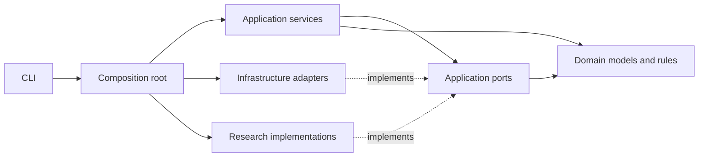

# 架构与边界

## 依赖方向

采用模块化单体与 Ports and Adapters。领域层只依赖标准库和 Pydantic；
应用层只认识领域对象和窄接口，供应商 SDK、HTTP、SQLite 不进入核心流程。
所有依赖在 `bootstrap.py` 显式装配，没有 Service Locator 或导入时联网/建表。
当前规模优先 SQLite，后续用 PostgreSQL 替换 Repository 不影响业务规则。

## SOLID 的具体约束

- SRP：证据校验、向量规则、持久化、HTTP 策略、流程编排各自承担一个职责。
- OCP：新增语料源、Embedding、Gap 策略或 LLM，只实现对应 Protocol 并修改装配。
- LSP：实现须保持数量、来源 ID、错误语义；契约测试验证替换行为。
- ISP：搜索、引文扩展、解析、抽取、归一化、生成、排序分别定义端口。
- DIP：流水线接收构造函数注入的端口，禁止实例化具体数据库或 HTTP 客户端。

使用 Repository、Adapter、Strategy 和 Composition Root；不为设计模式堆积抽象工厂。
Gap 的两种发现策略保持可组合。领域模型 frozen，集合使用 tuple，额外字段拒收。

## 数据与质量闸门

输入为已经限定范围且解析完毕的 Document。论文来源搜索和全文获取位于流水线上游。
每条证据绑定 paper_id/section_id，审稿局限性必须引用 review 章节。
抽取失败或证据不符时有限次重抽；耗尽后抛错，不把不完整提取交给图分析。
相似度只产生同义候选，实体合并仍需同义裁决与持久别名表。

Gap 必须带语料内证据；生成、修订、新颖性报告、卡片的 ID 都应保持连续。
生成批次全局去重后才进入新颖性检查。检索失败不等于新颖，未完成报告不能输出卡片。
三层查重判断证据必须存入报告；排序只能聚合三个成对比赛的结果。
最终 IdeaCard 默认 human_decision=pending，由人终审。

## 时间与可复现性

`as_of` 必传，基础编排拒绝缺失年份或晚于截断年份的论文。
目前只做到年份级入口检查。正式回溯需要发表日期、冻结检索/引用图、模型版本、
提示词版本、随机种子、语料哈希和预算账本；禁止把当前互联网结果用于历史新颖性判断。
这些能力列入 V01 和生产化阶段，当前不宣称无时间泄漏。

## 状态与失败

SQLite initialize 显式调用，参数化 SQL，批量卡片写入为一个事务，schema user_version=1。
缓存仅在响应通过解析后保存，密钥不进入缓存键。HTTP 客户端由调用方关闭。
适配器默认每个 worker 一个实例；当前限速器不跨进程共享。
研究骨架抛 CapabilityNotImplemented；供应商故障抛 ProviderError；质量闸门抛专用错误。
复杂研究函数不得返回空列表伪装成功，也不得吞掉异常输出新颖性通过。
